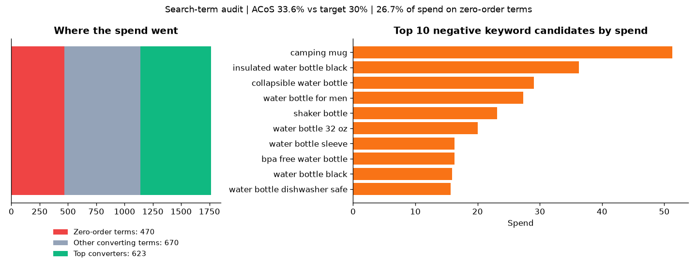
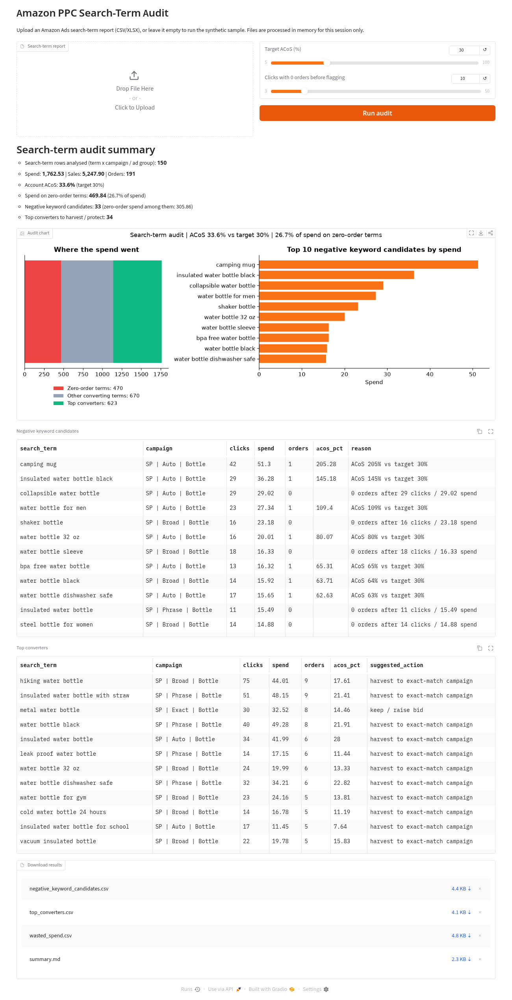

# Amazon PPC Search-Term Audit

[](LICENSE)

**A small Python tool that reads an Amazon Ads search-term report and tells you where the money leaks.**

It flags three things every Sponsored Products account review starts with:

| Output | Rule (defaults, all adjustable) | What to do with it |
|---|---|---|
| **Wasted spend** | Any search term with spend and 0 orders | See how much of the budget buys no sales |
| **Negative keyword candidates** | 0 orders after ≥10 clicks, or 0 orders after spend ≥ (average order value × target ACoS), or ACoS > 2× target on ≤1 order (with ≥10 clicks) | Add as negative exact, or bid down |
| **Top converters** | ≥2 orders at or below target ACoS | Harvest broad/phrase/auto winners into an exact-match campaign; protect exact winners |



## Quick start

```bash
pip install -r requirements.txt
python ppc_audit.py sample/search_term_report_sample.csv --target-acos 30 --out audit_output
```

Output (synthetic sample, 30-day report):

```text
- Search-term rows analysed (term x campaign / ad group): 150
- Spend: 1,762.53 | Sales: 5,247.90 | Orders: 191
- Account ACoS: 33.6% (target 30%)
- Spend on zero-order terms: 469.84 (26.7% of spend)
- Negative keyword candidates: 33 (zero-order spend among them: 305.86)
- Top converters to harvest / protect: 34
```

Files written to the output folder (see [`examples/output/`](examples/output)):

- `summary.md`: the headline numbers plus the top 10 negatives and converters
- `negative_keyword_candidates.csv`: term, campaign, clicks, spend, orders, ACoS, reason, suggested action
- `top_converters.csv`: term, match type, orders, sales, ACoS, CVR, suggested action
- `wasted_spend.csv`: every zero-order term, sorted by spend
- `audit_chart.png`: spend split and the top 10 negatives by spend

### Options

```text
--target-acos 30     target ACoS in percent
--min-clicks 10      clicks with 0 orders before a term becomes a negative candidate
--min-spend X        spend with 0 orders before flagging (default: average order value x target ACoS)
--min-orders 2       orders needed to count as a top converter
--out DIR            output folder
--no-chart           skip the PNG
```

## Using your own report

In Amazon Ads: **Reports → Sponsored Products → Search term**, choose a 30 or 60-day summary, download CSV or XLSX, and point the script at it.
Header names are matched loosely (case, extra spaces, `7 Day` vs `14 Day` attribution), so most marketplace exports work as-is. The required columns are search term, clicks, spend, sales and orders.

Your report stays on your machine: the script makes no network calls.

## Browser demo (Gradio)

```bash
pip install gradio
python app.py
```

Upload a report (or leave it empty for the sample), set the target ACoS, and download the CSVs.



## Synthetic sample data

`sample/search_term_report_sample.csv` is **fully synthetic**: a fictional insulated water bottle, made-up campaigns and search terms, and numbers from a seeded random model (relevant terms convert, wrong-intent and competitor terms mostly don't). No real store or account data is included. Regenerate it, or build a bigger daily version, with:

```bash
python sample/generate_sample.py --out sample/search_term_report_sample.csv
python sample/generate_sample.py --days 60 --out daily.csv
```

## Tests

```bash
pip install -r requirements-dev.txt
pytest -q
```

CI runs the tests and the sample audit on Python 3.10 and 3.12.

## Limitations

- Thresholds are starting points, not rules. A term with a few clicks may just need more data, and some zero-order terms still drive ranking or brand awareness.
- Amazon attributes orders over 7 or 14 days, so very recent spend can look worse than it is. Leave a few days before acting.
- The tool reads one report; it does not change bids or negatives in your account.

## Related

- Kaggle notebook: [PPC Wasted-Spend Audit: CPA, ROAS & Reallocation](https://www.kaggle.com/code/shahzadrazaa/ppc-wasted-spend-audit-cpa-roas-reallocation)
- Free listing health checklist: https://adsmithai.gumroad.com/l/rxzumn

---

**Author:** [Shahzad Raza](https://github.com/Shahzrazaa) · MIT License
